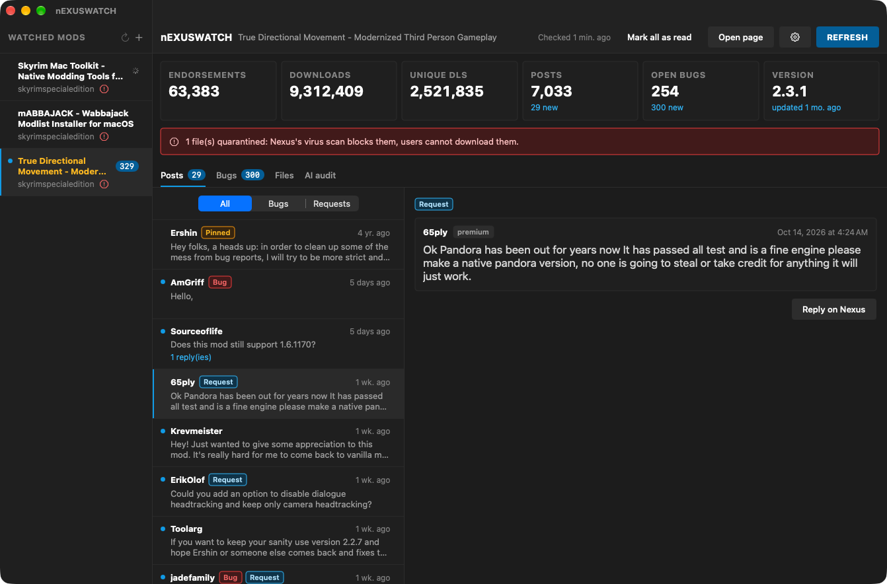
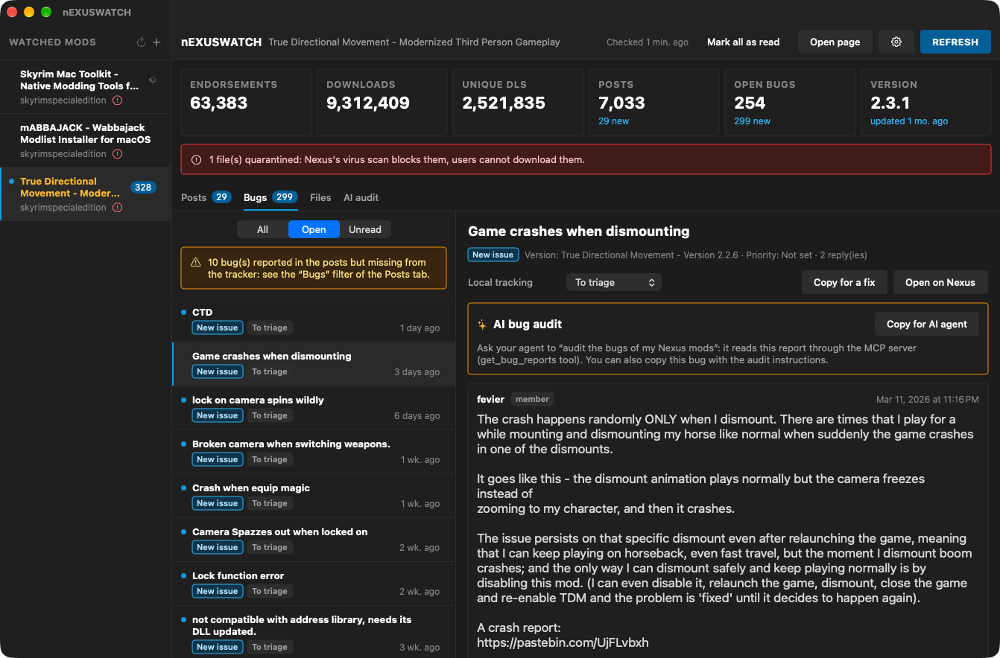
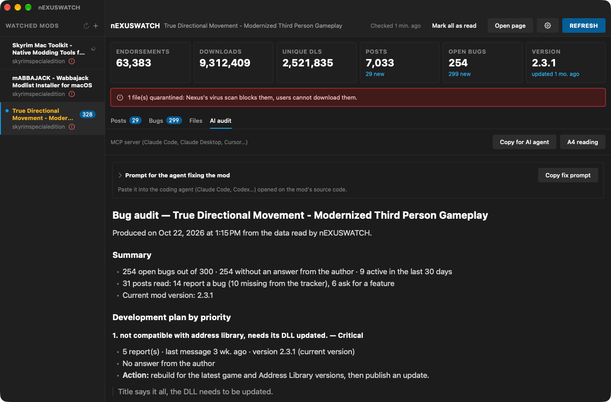
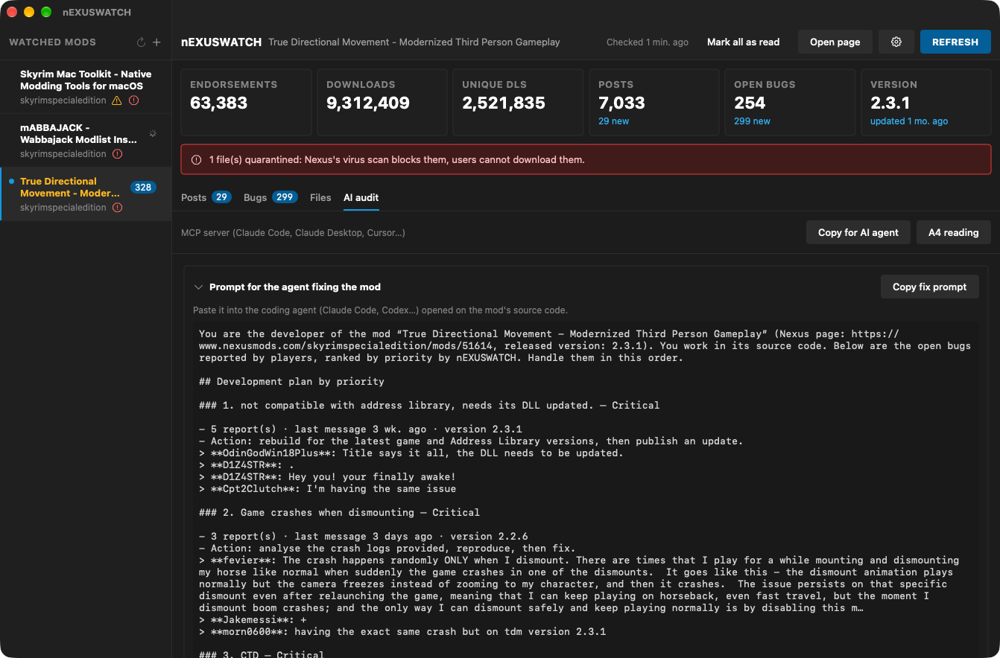
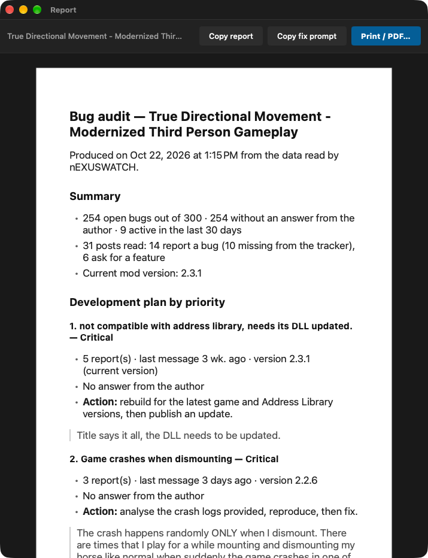
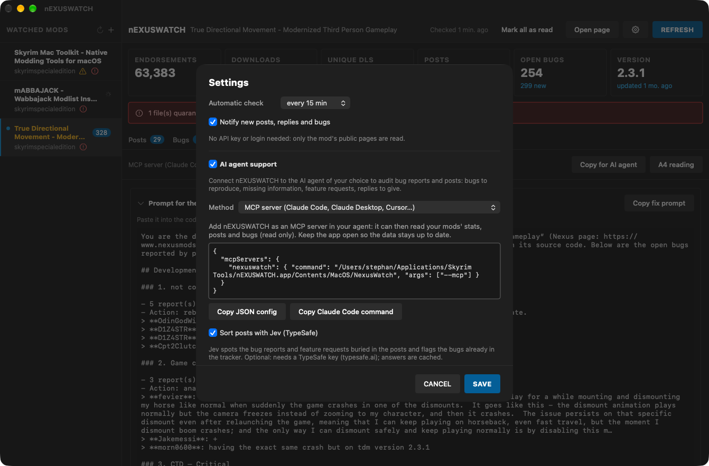

# nEXUSWATCH

**For mod authors: keeps an eye on your Nexus Mods pages — stats, posts, bug reports and files — and turns the bug reports into a development plan.**  
*Pour les auteurs de mods : surveille vos pages Nexus Mods — stats, posts, rapports de bugs et fichiers — et fait des rapports de bugs un plan de développement.*

🇬🇧 [English](#-english) · 🇫🇷 [Français](#-français)

---
## 🇬🇧 English

### What it does

Publishing a mod means checking its page again and again for new comments, bug reports or a file stuck in the virus scan. nEXUSWATCH does it for you in the background and notifies you when something new comes in. No API key, no login: it only reads the mod's public pages. Version 1.1 audits the bug reports for you and can hand them to the AI agent of your choice.

### Features

- **New in 1.1 — several mods**: watch all your mod pages in one window, with unread counts in the sidebar.
- **New in 1.1 — bug audit**: open bugs ranked by priority (critical, high, medium, low) with the action to take for each, bugs their authors say are solved, bug reports hidden in posts and feature requests. Works without AI, in the app's language.
- **New in 1.1 — A4 report**: read the audit as an A4 page, print it or save it as PDF.
- **New in 1.1 — fix prompt**: a ready-to-paste brief for the coding agent that will fix the mod (bugs by priority with the players' messages, method, expected report).
- **New in 1.1 — AI agent support** (optional, off by default): copy or export the data, any OpenAI-compatible API (OpenAI, Mistral, OpenRouter, Ollama, LM Studio), Anthropic Claude, or the built-in MCP server for Claude Code, Claude Desktop or Cursor. Per-bug audit included.
- **New in 1.1 — Jev sorting** (optional, TypeSafe API key): flags posts that report a bug or ask for a feature, and spots those already in the bug tracker.
- **Stats**: endorsements, downloads, unique downloads, version and 24-hour progress.
- **Posts**: latest threads with their replies, "New" badge, your own messages marked as read.
- **Bugs**: every report with its Nexus status and full messages, local tracking (To triage → Fix released), test notes and **Copy for a fix** (Markdown report to the clipboard).
- **Files**: downloads per file and Nexus virus-scan status (quarantined files flagged).
- Automatic check (5 min to 3 h), macOS notification and Dock badge; keeps running when the window is closed.
- Interface in **English, French, Italian and Spanish** (follows your Mac's language).

### Screenshots


*Several mods in the sidebar; posts sorted by Jev into bug reports and feature requests*


*Bug report with local tracking and the per-bug AI audit*


*Bug audit: development plan ranked by priority, without AI*


*Ready-to-paste prompt for the agent that fixes the mod*


*The audit as an A4 page, to print or save as PDF*


*Settings: pick your AI agent method (export, OpenAI-compatible, Claude, MCP server) and Jev sorting*

### Requirements

A Mac with **Apple Silicon** (M1 or later), **macOS 14 Sonoma** or later. No Python, no Wine, no virtual machine needed.

### Installation

1. Download the zip from Nexus Mods (or from the GitHub releases) and unzip it.
2. Move **nEXUSWATCH.app** to your **Applications** folder.
3. First launch: the app is signed with a personal certificate but **not notarized by Apple**, so macOS blocks it. Open **System Settings → Privacy & Security**, scroll down and click **Open Anyway** next to nEXUSWATCH, then confirm. On macOS 14 or earlier you can also right-click the app → **Open** → **Open**.
4. Still blocked? In Terminal: `xattr -dr com.apple.quarantine /Applications/nEXUSWATCH.app`

### How to use

1. Open nEXUSWATCH, click the gear icon and paste the URL of your mod page.
2. Pick the check interval and turn on notifications.
3. Read new posts and bugs in their tabs; **Reply on Nexus** opens the right page.
4. Add your other mods with **+** in the sidebar.
5. Open the **AI audit** tab for the priority plan: **A4 reading** prints it or saves it as PDF, **Copy fix prompt** gives the brief for your coding agent.
6. Optional: in the settings, turn on **AI agent support** and pick a method.

### FAQ

**"The mod page is not responding".**  
Nexus sometimes shows a Cloudflare check: wait a moment and click **Refresh**.

**How do I connect Claude Code?**  
Choose **MCP server** in the settings and copy the command shown, for example `claude mcp add -s user nexuswatch -- "/Applications/nEXUSWATCH.app/Contents/MacOS/NexusWatch" --mcp`. Then ask Claude about your mods from any session (tools `list_mods`, `get_mod_report`, `get_bug_reports`, `get_fix_prompt`).

### Privacy

Only the mod's public pages and the public Nexus Mods GraphQL API are read, without account or API key. Read status, bug tracking and notes stay on your Mac (~/Library/Application Support/nEXUSWATCH). The optional AI features send the mod's public posts and bug reports only to the service you choose, with your own API key (stored in the macOS Keychain); Jev sorting sends the post texts to TypeSafe. With the MCP server or the export, nothing leaves your Mac unless your agent asks for it.

### Building from source

Requires Python 3.12 with PyQt6 and PyInstaller. From the repository folder:

```bash
./build_app.sh
```

### License

Released under the **MIT License**: free to use, modify and share. Part of the **Skyrim Mac Toolkit**, a set of modding tools built for Skyrim players on Mac.

---

## 🇫🇷 Français

### À quoi ça sert

Publier un mod, c'est retourner sans cesse sur sa page pour guetter un commentaire, un rapport de bug ou un fichier bloqué par l'antivirus. nEXUSWATCH s'en charge en arrière-plan et vous prévient dès qu'il y a du nouveau. Ni clé API ni connexion : il ne lit que les pages publiques du mod. La version 1.1 audite les rapports de bugs pour vous et peut les confier à l'agent IA de votre choix.

### Fonctions

- **Nouveau en 1.1 — plusieurs mods** : toutes vos pages de mods dans une seule fenêtre, avec les non-lus dans la barre latérale.
- **Nouveau en 1.1 — audit des bugs** : bugs ouverts classés par priorité (critique, haute, moyenne, basse) avec l'action à mener pour chacun, bugs que leurs auteurs disent résolus, bugs cachés dans les posts et demandes de fonctions. Sans IA, dans la langue de l'appli.
- **Nouveau en 1.1 — rapport A4** : lisez l'audit en page A4, imprimez-le ou enregistrez-le en PDF.
- **Nouveau en 1.1 — prompt de correction** : consigne prête à coller dans l'agent qui corrigera le mod (bugs par priorité avec les messages des joueurs, méthode, compte rendu attendu).
- **Nouveau en 1.1 — support d'agent IA** (facultatif, désactivé par défaut) : copie ou export des données, toute API compatible OpenAI (OpenAI, Mistral, OpenRouter, Ollama, LM Studio), Anthropic Claude, ou le serveur MCP intégré pour Claude Code, Claude Desktop ou Cursor. Audit bug par bug inclus.
- **Nouveau en 1.1 — tri Jev** (facultatif, clé API TypeSafe) : repère les posts qui signalent un bug ou demandent une fonction, et ceux déjà présents dans le tracker.
- **Stats** : endorsements, téléchargements, DL uniques, version et progression sur 24 h.
- **Posts** : derniers fils avec leurs réponses, badge « Nouveau », vos propres messages lus d'office.
- **Bugs** : tous les rapports avec leur statut Nexus et leurs messages complets, suivi local (À trier → Correctif publié), notes de test et **Copier pour correctif** (rapport Markdown dans le presse-papiers).
- **Fichiers** : téléchargements par fichier et état du contrôle antivirus Nexus (quarantaine signalée).
- Vérification automatique (5 min à 3 h), notification macOS et badge du Dock ; l'appli continue fenêtre fermée.
- Interface en **français, anglais, italien et espagnol** (suit la langue du Mac).

### Captures d'écran


*Plusieurs mods dans la barre latérale ; posts triés par Jev en bugs et demandes*


*Rapport de bug avec suivi local et audit IA du bug*


*Audit des bugs : plan de développement par priorité, sans IA*


*Prompt prêt à coller pour l'agent qui corrige le mod*


*L'audit en page A4, à imprimer ou enregistrer en PDF*


*Réglages : méthode d'agent IA (export, compatible OpenAI, Claude, serveur MCP) et tri Jev*

### Configuration requise

Un Mac **Apple Silicon** (M1 ou plus récent), **macOS 14 Sonoma** ou plus récent. Ni Python, ni Wine, ni machine virtuelle.

### Installation

1. Téléchargez le zip sur Nexus Mods (ou dans les releases GitHub) et décompressez-le.
2. Placez **nEXUSWATCH.app** dans votre dossier **Applications**.
3. Premier lancement : l'appli est signée avec un certificat personnel mais **pas notarisée par Apple**, macOS la bloque donc. Ouvrez **Réglages Système → Confidentialité et sécurité**, descendez et cliquez sur **Ouvrir quand même** à côté de nEXUSWATCH, puis confirmez. Sous macOS 14 ou antérieur, vous pouvez aussi faire clic droit sur l'appli → **Ouvrir** → **Ouvrir**.
4. Toujours bloquée ? Dans le Terminal : `xattr -dr com.apple.quarantine /Applications/nEXUSWATCH.app`

### Utilisation

1. Ouvrez nEXUSWATCH, cliquez sur la roue dentée et collez l'URL de la page de votre mod.
2. Choisissez l'intervalle de vérification et activez les notifications.
3. Lisez les nouveaux posts et bugs dans leurs onglets ; **Répondre sur Nexus** ouvre la bonne page.
4. Ajoutez vos autres mods avec **+** dans la barre latérale.
5. Ouvrez l'onglet **Audit IA** pour le plan par priorité : **Lecture A4** l'imprime ou l'enregistre en PDF, **Copier le prompt de correction** donne la consigne pour votre agent de développement.
6. Facultatif : dans les réglages, activez le **support agent IA** et choisissez une méthode.

### Questions fréquentes

**« La page du mod ne répond pas ».**  
Nexus affiche parfois un contrôle Cloudflare : patientez un instant puis cliquez sur **Actualiser**.

**Comment brancher Claude Code ?**  
Choisissez **Serveur MCP** dans les réglages et copiez la commande affichée, par exemple `claude mcp add -s user nexuswatch -- "/Applications/nEXUSWATCH.app/Contents/MacOS/NexusWatch" --mcp`. Interrogez ensuite Claude sur vos mods depuis n'importe quelle session (outils `list_mods`, `get_mod_report`, `get_bug_reports`, `get_fix_prompt`).

### Confidentialité

Seules les pages publiques du mod et l'API GraphQL publique de Nexus Mods sont lues, sans compte ni clé API. L'état lu, le suivi des bugs et les notes restent sur votre Mac (~/Library/Application Support/nEXUSWATCH). Les fonctions IA facultatives n'envoient les posts et rapports de bugs publics du mod qu'au service que vous choisissez, avec votre propre clé API (rangée dans le trousseau macOS) ; le tri Jev envoie le texte des posts à TypeSafe. Avec le serveur MCP ou l'export, rien ne quitte votre Mac sans que votre agent le demande.

### Compiler depuis les sources

Nécessite Python 3.12 avec PyQt6 et PyInstaller. Depuis le dossier du dépôt :

```bash
./build_app.sh
```

### Licence

Publié sous **licence MIT** : libre d'utilisation, de modification et de partage. Fait partie du **Skyrim Mac Toolkit**, un ensemble d'outils de modding pensés pour les joueurs de Skyrim sur Mac.
