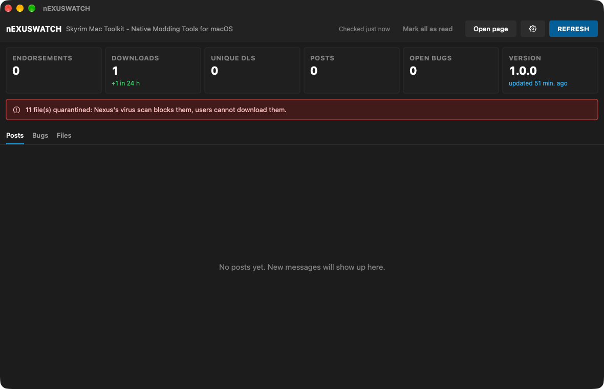

# nEXUSWATCH

**For mod authors: keeps an eye on your Nexus Mods pages — stats, posts, bug reports and files — without opening it.**  
*Pour les auteurs de mods : surveille vos pages Nexus Mods — stats, posts, rapports de bugs et fichiers — sans l'ouvrir.*

🇬🇧 [English](#-english) · 🇫🇷 [Français](#-français)

---
## 🇬🇧 English

### What it does

Publishing a mod means checking its page again and again for new comments, bug reports or a file stuck in the virus scan. nEXUSWATCH does it for you in the background and notifies you when something new comes in. No API key, no login: it only reads the mod's public pages.

### Features

- **Several mods**: watch as many mod pages as you like from the sidebar, each with its own unread count.
- **Stats**: endorsements, downloads, unique downloads, version and 24-hour progress.
- **Posts**: latest threads with their replies, "New" badge, your own messages marked as read.
- **Bugs**: every report with its Nexus status and full messages, local tracking (To triage → Fix released), test notes and **Copy for a fix** (Markdown report to the clipboard).
- **Files**: downloads per file and Nexus virus-scan status (quarantined files flagged).
- **AI agent support** (optional, in the settings): sends the stats and posts to the AI agent of your choice, which audits them: bug reports first (duplicates merged, missing information, likely cause, severity, next action), then every post (bugs, feature requests, questions, suggested replies) and an action plan. Four methods: Markdown export to paste anywhere, OpenAI-compatible API (OpenAI, Mistral, OpenRouter, Ollama, LM Studio…), Anthropic API (Claude) or local MCP server (Claude Code, Claude Desktop, Cursor…). Each bug also gets its own in-depth audit in the Bugs tab (missing information, likely causes, reply to the reporter). On demand or automatically when new bugs or posts arrive; API keys stay in the macOS keychain.
- Automatic check (5 min to 3 h), macOS notification and Dock badge; keeps running when the window is closed.
- Interface in **English, French, Italian and Spanish** (follows your Mac's language).

### Screenshots


*Mod stats, quarantine alert and posts*

### Requirements

A Mac with **Apple Silicon** (M1 or later), **macOS 14 Sonoma** or later. No Python, no Wine, no virtual machine needed.

### Installation

1. Download the zip from Nexus Mods (or from the GitHub releases) and unzip it.
2. Move **nEXUSWATCH.app** to your **Applications** folder.
3. First launch: the app is signed with a personal certificate but **not notarized by Apple**, so macOS blocks it. Open **System Settings → Privacy & Security**, scroll down and click **Open Anyway** next to nEXUSWATCH, then confirm. On macOS 14 or earlier you can also right-click the app → **Open** → **Open**.
4. Still blocked? In Terminal: `xattr -dr com.apple.quarantine /Applications/nEXUSWATCH.app`

### How to use

1. Open nEXUSWATCH, click **+** in the sidebar and paste the URL of a mod page; repeat for each mod.
2. Click the gear icon to pick the check interval and turn on notifications.
3. Right-click a mod in the sidebar to remove it.
4. Optional: turn on **AI agent support** in the settings, pick a method, then use the **AI report** tab.
5. Read new posts and bugs in their tabs; **Reply on Nexus** opens the right page.

### FAQ

**"The mod page is not responding".**  
Nexus sometimes shows a Cloudflare check: wait a moment and click **Refresh**.

### Privacy

Only the mod's public pages and the public Nexus Mods GraphQL API are read, without account or API key. With AI agent support on, the mod's stats, posts and bug reports are sent only to the AI service you chose, and only when an analysis runs; API keys are kept in the macOS keychain. Read status, bug tracking and notes stay on your Mac (~/Library/Application Support/nEXUSWATCH).

### Building from source

Requires the Xcode Command Line Tools (Swift 5.9 or later). From the repository folder:

```bash
./build_app.sh
```

### License

Released under the **MIT License**: free to use, modify and share. Part of the **Skyrim Mac Toolkit**, a set of modding tools built for Skyrim players on Mac.

---

## 🇫🇷 Français

### À quoi ça sert

Publier un mod, c'est retourner sans cesse sur sa page pour guetter un commentaire, un rapport de bug ou un fichier bloqué par l'antivirus. nEXUSWATCH s'en charge en arrière-plan et vous prévient dès qu'il y a du nouveau. Ni clé API ni connexion : il ne lit que les pages publiques du mod.

### Fonctions

- **Plusieurs mods** : suivez autant de pages de mods que vous voulez depuis la barre latérale, chacune avec son compteur de non-lus.
- **Stats** : endorsements, téléchargements, DL uniques, version et progression sur 24 h.
- **Posts** : derniers fils avec leurs réponses, badge « Nouveau », vos propres messages lus d'office.
- **Bugs** : tous les rapports avec leur statut Nexus et leurs messages complets, suivi local (À trier → Correctif publié), notes de test et **Copier pour correctif** (rapport Markdown dans le presse-papiers).
- **Fichiers** : téléchargements par fichier et état du contrôle antivirus Nexus (quarantaine signalée).
- **Support agent IA** (facultatif, dans les réglages) : envoie les stats et les posts à l'agent IA de votre choix, qui en fait l'audit : les rapports de bugs d'abord (doublons regroupés, informations manquantes, cause probable, gravité, action à mener), puis chaque post (bugs, demandes de fonctions, questions, réponses suggérées) et un plan d'action. Quatre méthodes : export Markdown à coller où vous voulez, API compatible OpenAI (OpenAI, Mistral, OpenRouter, Ollama, LM Studio…), API Anthropic (Claude) ou serveur MCP local (Claude Code, Claude Desktop, Cursor…). Chaque bug a aussi son audit approfondi dans l'onglet Bugs (informations manquantes, causes probables, réponse au rapporteur). À la demande ou automatiquement à l'arrivée de nouveaux bugs ou posts ; les clés API restent dans le trousseau macOS.
- Vérification automatique (5 min à 3 h), notification macOS et badge du Dock ; l'appli continue fenêtre fermée.
- Interface en **français, anglais, italien et espagnol** (suit la langue du Mac).

### Captures d'écran


*Stats du mod, alerte de quarantaine et posts*

### Configuration requise

Un Mac **Apple Silicon** (M1 ou plus récent), **macOS 14 Sonoma** ou plus récent. Ni Python, ni Wine, ni machine virtuelle.

### Installation

1. Téléchargez le zip sur Nexus Mods (ou dans les releases GitHub) et décompressez-le.
2. Placez **nEXUSWATCH.app** dans votre dossier **Applications**.
3. Premier lancement : l'appli est signée avec un certificat personnel mais **pas notarisée par Apple**, macOS la bloque donc. Ouvrez **Réglages Système → Confidentialité et sécurité**, descendez et cliquez sur **Ouvrir quand même** à côté de nEXUSWATCH, puis confirmez. Sous macOS 14 ou antérieur, vous pouvez aussi faire clic droit sur l'appli → **Ouvrir** → **Ouvrir**.
4. Toujours bloquée ? Dans le Terminal : `xattr -dr com.apple.quarantine /Applications/nEXUSWATCH.app`

### Utilisation

1. Ouvrez nEXUSWATCH, cliquez sur **+** dans la barre latérale et collez l'URL de la page d'un mod ; recommencez pour chaque mod.
2. Cliquez sur la roue dentée pour choisir l'intervalle de vérification et activer les notifications.
3. Clic droit sur un mod de la barre latérale pour le retirer.
4. Facultatif : activez le **Support agent IA** dans les réglages, choisissez une méthode puis utilisez l'onglet **Rapport IA**.
5. Lisez les nouveaux posts et bugs dans leurs onglets ; **Répondre sur Nexus** ouvre la bonne page.

### Questions fréquentes

**« La page du mod ne répond pas ».**  
Nexus affiche parfois un contrôle Cloudflare : patientez un instant puis cliquez sur **Actualiser**.

### Confidentialité

Seules les pages publiques du mod et l'API GraphQL publique de Nexus Mods sont lues, sans compte ni clé API. Avec le support agent IA, les stats, posts et rapports de bugs du mod ne sont envoyés qu'au service IA que vous avez choisi, et seulement lors d'une analyse ; les clés API restent dans le trousseau macOS. L'état lu, le suivi des bugs et les notes restent sur votre Mac (~/Library/Application Support/nEXUSWATCH).

### Compiler depuis les sources

Nécessite les Xcode Command Line Tools (Swift 5.9 ou plus récent). Depuis le dossier du dépôt :

```bash
./build_app.sh
```

### Licence

Publié sous **licence MIT** : libre d'utilisation, de modification et de partage. Fait partie du **Skyrim Mac Toolkit**, un ensemble d'outils de modding pensés pour les joueurs de Skyrim sur Mac.
